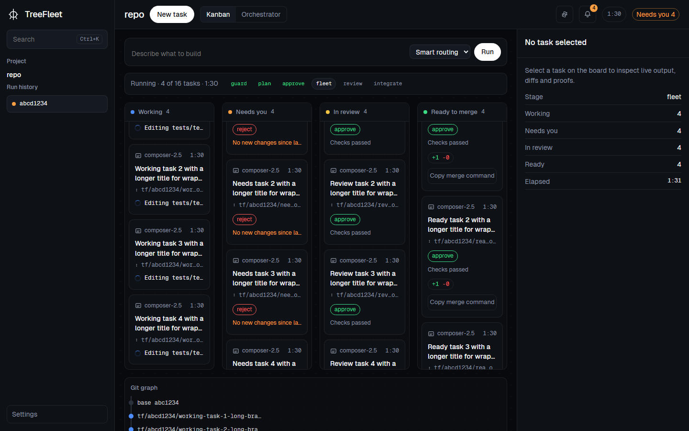
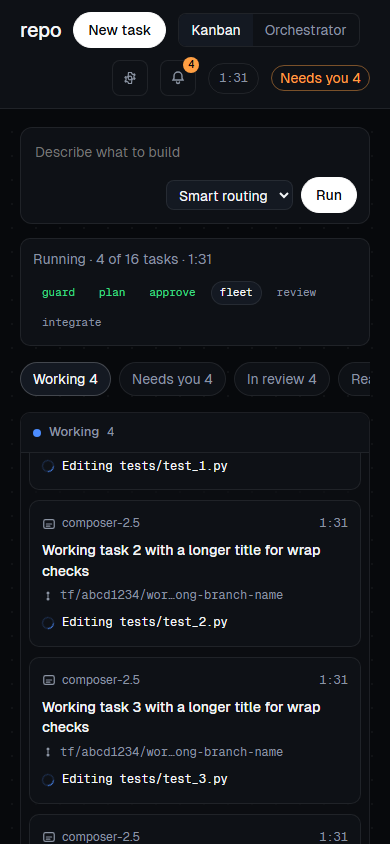
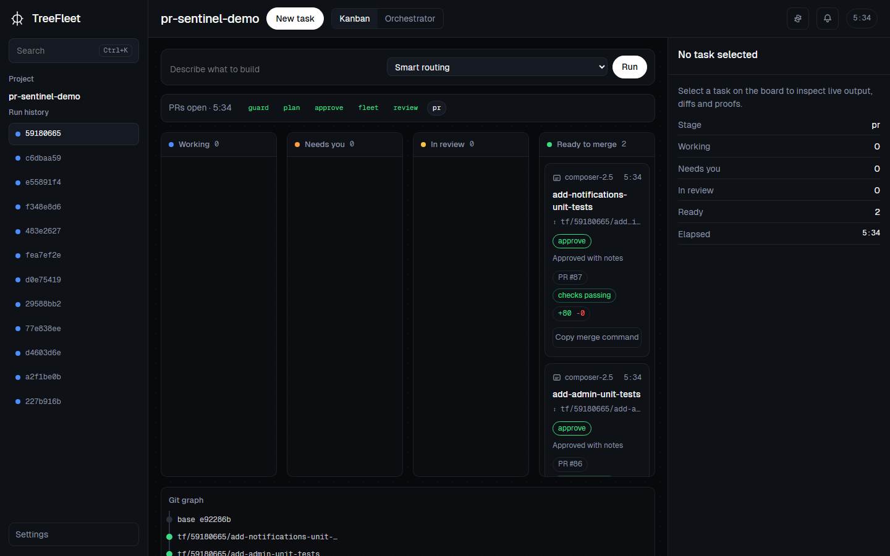
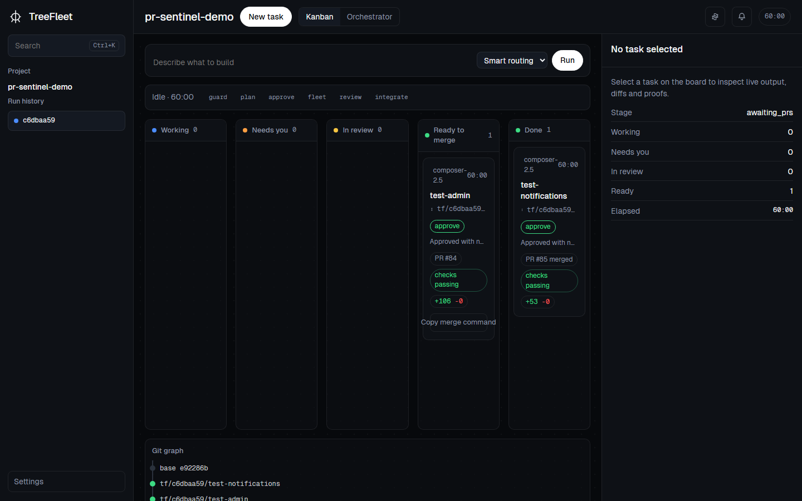
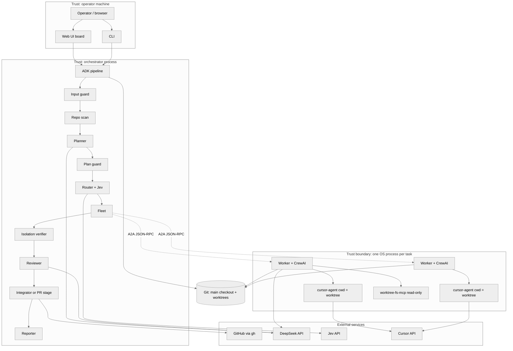
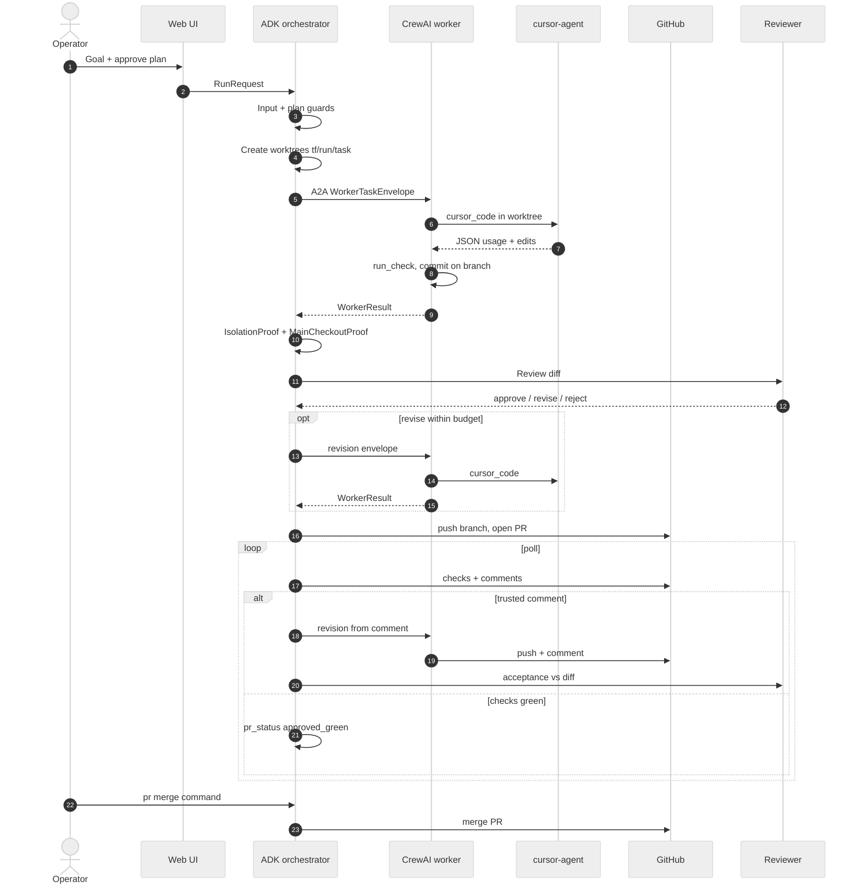
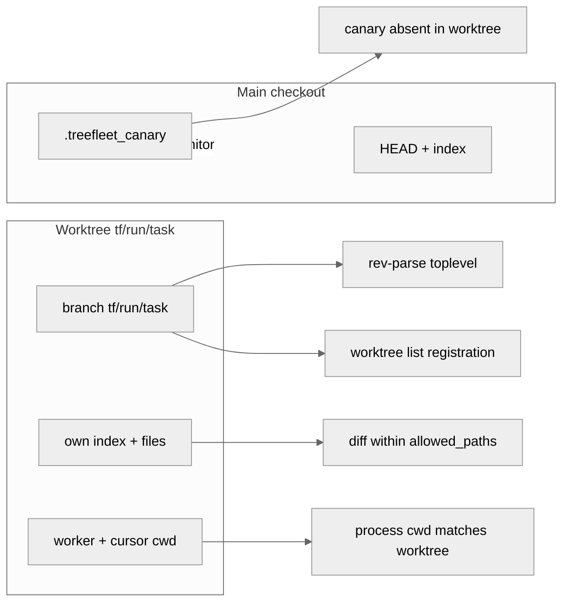
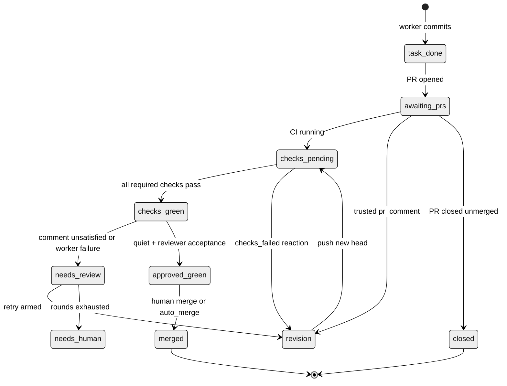
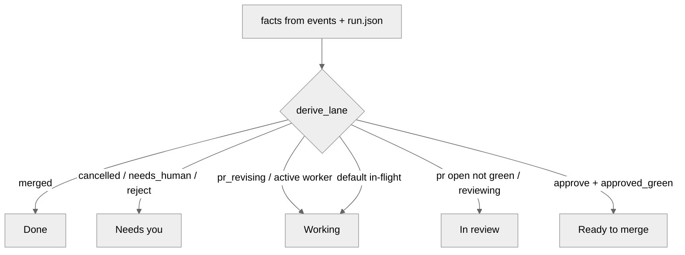

# TreeFleet

Parallel coding agents in isolated git worktrees, with a pull-request, CI, and review feedback loop—built only on **Google ADK** and **CrewAI**.

[](https://www.python.org/downloads/)
[](LICENSE)

| Desktop board (1440) | Mobile board (390) |
|---|---|
|  |  |

| PR rehearsal — ready lane | Live PR session |
|---|---|
|  |  |

---

## Status

**Pre-1.0, research-grade.** The offline gate (`scripts/gate.py`, phases 0–11) and unit tests are the contract of correctness. **Verified with real models** in recorded runs under `evidence/` (planner, workers, Cursor, reviewer, isolation proofs). **Not production-hardened:** no hosted multi-tenant control plane, Langfuse wiring is deferred (phase 7), and Windows Cursor runs without a sandbox—scope revert and proofs are the boundary.

| Area | Verified live | Offline / faked |
|---|---|---|
| Isolation proofs | `evidence/phase-2/`, phase-6 live runs | Windows sibling/main mutation tests |
| ADK orchestrator + A2A workers | `evidence/phase-4/` … `phase-6/` | Scripted `BaseLlm` in gate |
| Guards + Jev | `evidence/phase-5/guard-demo/` | Respx / scripted Jev |
| Web UI board | `evidence/phase-8/` | Playwright harness |
| Eval harness | `eval/report.md`, `evidence/phase-9/` | E5 forced-plan hook |
| PR loop (`gh`) | `evidence/phase-11/`, `evidence/phase-12/rehearsal/` | `FakeProvider` in tests |

---

## Why TreeFleet

Parallel agent products often share one checkout or trust workers to stay in scope. That makes races likely and “isolation” a claim in a log line. Code review, CI, and agent output are usually separate channels, so a failing check or a trusted PR comment does not automatically become structured revision work on the right branch.

TreeFleet treats **one goal → many tasks → many branches** as the default shape. Each task runs in its own **git worktree** and **OS process**. The orchestrator never lets workers talk to each other; cross-task data flows only through typed contracts (`src/treefleet/contracts.py`). **Isolation is re-computed** from git and the process tree after every wave—not from `WorkerResult.isolation`. When `[pr]` is enabled, approved tasks become real pull requests; the same reaction table drives check failures, trusted comments, conflicts, and provider errors.

---

## Feature overview

| Capability | What it does | Where |
|---|---|---|
| Typed contracts | Every cross-boundary payload is Pydantic | `src/treefleet/contracts.py` |
| Input + plan guards | Deterministic rules, then Jev scores | `src/treefleet/guards/` |
| ADK pipeline | Scan → plan → route → fleet → verify → review → integrate/PR → report | `src/treefleet/orchestrator/` |
| Hub-and-spoke fleet | Spawns workers, A2A dispatch, kills on shutdown | `src/treefleet/orchestrator/fleet.py` |
| CrewAI worker | DeepSeek brain, read-only MCP, `cursor_code` only writer | `src/treefleet/worker/` |
| Isolation proofs | cwd, toplevel, worktree list, canary, scope, main HEAD | `src/treefleet/git/proofs.py` |
| Review loop | approve / revise / reject; separate check-revise budget | `src/treefleet/orchestrator/review.py` |
| Reactions | Single `resolve()` entry; capped retries | `src/treefleet/reactions.py`, `docs/REACTIONS.md` |
| PR lifecycle | open, poll checks, trusted comments, acceptance | `src/treefleet/pr/`, `docs/PR_LIFECYCLE.md` |
| Board + SSE | Lanes, proof drawer, cost tab from `events.jsonl` | `src/treefleet/ui/` |
| Sessions | Heartbeat, kill, cleanup; no resume | `src/treefleet/sessions.py`, `docs/SESSIONS.md` |
| Cost lines | Per planner/worker/cursor/reviewer/jev row in report | `src/treefleet/guards/cost.py` |
| Gate | Ruff + pyright + cumulative pytest phases | `scripts/gate.py` |

---

## Architecture

### System context

Trust boundaries: the **operator UI/CLI** starts runs; the **orchestrator** holds secrets for planning/review; each **worker** gets a minimal env (model key, per-run A2A token, optional Cursor credential); **Cursor** is untrusted and may write only via its CLI in the worktree cwd.



<details>
<summary>SVG fallbacks</summary>

`mmdc` was not run in CI here: `@mermaid-js/mermaid-cli` requires `chrome-headless-shell`, which was missing on the doc build host. Sources live in `docs/img/diagrams/*.mmd` if you want to render locally.
</details>

### Run sequence (integrate or PR mode)



Deeper narrative: [`docs/ARCHITECTURE.md`](docs/ARCHITECTURE.md).

### Worktree isolation model

- **Main checkout** — untouched index/HEAD; `.treefleet_canary` proves workers did not read it as their root.
- **Per task** — `git worktree add <worktree-root>/<run_id>/<task_id> -b tf/<run_id>/<task_id>`.
- **Branch naming** — `tf/<run_id>/<task_id>` (integration: `tf/<run_id>/integrated` when not in PR mode).



### PR lifecycle and reactions

When `[pr] enabled = true`, tasks move through poll-driven states. Lane labels on the board are derived from the **latest** `pr_status` and related facts ([`src/treefleet/ui/lanes.py`](src/treefleet/ui/lanes.py)).



| Event | Default action | retries | Notes |
|---|---|---|---|
| `checks_failed` | `send_to_agent` | 1 | Separate from reviewer revise budget |
| `review_revise` | `send_to_agent` | 1 (max 2 via `[revise]`) | `round_budget_s` default 240 |
| `review_rejected` | `needs_human` | 0 | Cannot be `ignore` |
| `merge_conflict` | `send_to_agent` | 1 | One resolve round per task |
| `provider_error` | `send_to_agent` | 3 | Escalate model after attempt 2 |
| `task_failed` | `needs_human` | 0 | |
| `needs_review` | `notify` | 0 | |
| `approved_green` | `ignore` | 0 | PR mode may notify |
| `run_done` | `notify` | 0 | |

Full inventory: [`docs/REACTIONS.md`](docs/REACTIONS.md). Hard cap **5** attempts per reaction key; guards and proofs are not reaction keys.

### Board lanes

| Lane | Primary facts | Rule of thumb |
|---|---|---|
| **Working** | `worker_active`, `fleet_in_progress`, `pr_revising` | Agent or PR revision in flight |
| **Needs you** | `needs_human`, `reject`, failed checks (non-PR), `cancelled` | Latest decision wins over stale approve |
| **In review** | `pr_open` without green, `review_started` | Awaiting checks or reviewer |
| **Ready to merge** | `pr_status == approved_green` or approve + quiet | PR mode needs green + acceptance |
| **Done** | `pr_status == merged` or integrated flow complete | |



---

## Design decisions

| Topic | Why |
|---|---|
| **ADK + CrewAI only** | One orchestrator framework and one worker framework; A2A is the seam. No LangChain graph in the hot path ([`AGENTS.md`](AGENTS.md)). |
| **Hub-and-spoke** | Workers never address each other; every dependency is explicit in the plan and logged. |
| **Cursor writes, DeepSeek reasons** | Files change only when `cursor_code` launches `cursor-agent` with `cwd` = worktree; the CrewAI agent has no write tool. |
| **Proofs, not claims** | `IsolationProof` is computed in Python; worker-reported cwd is evidence, not verdict. |
| **Single `resolve()`** | All automated reactions go through one function with a 5-attempt ceiling. |
| **Two revise budgets** | Failing checks and reviewer `revise` each have their own retry counters ([`docs/REACTIONS.md`](docs/REACTIONS.md)). |
| **Untrusted diffs and comments** | Reviewer sees redacted diffs; PR comments pass through the input guard and `<untrusted-data>` wrapping (1800-char cap). |
| **Revision acceptance** | A trusted comment stays open until a reviewer accepts the new diff against that comment ([`docs/PR_LIFECYCLE.md`](docs/PR_LIFECYCLE.md)). |
| **No session resume** | `run.json` + `events.jsonl` support inspect and cleanup, not mid-task replay ([`docs/SESSIONS.md`](docs/SESSIONS.md)). |
| **Human merge by default** | `merge()` runs only when `auto_merge` is true or the operator runs `treefleet pr merge`. |

---

## Security model

| Threat | Control | Reference |
|---|---|---|
| Untrusted PR comment | `trusted_commenters`, guard + wrap, stale/own filters | `docs/PR_LIFECYCLE.md` |
| Malicious diff text | Reviewer prompts treat diff as data; redaction in events | `src/treefleet/guards/text.py` |
| Runaway worker | Per-step timeouts, process-tree kill, Windows Job Object kill-on-close | `docs/SESSIONS.md` |
| Scope escape | Post-cursor scope diff + revert; proof failures fail the task | `src/treefleet/git/cursor_scope.py` |
| Force push / wrong remote | Single refspec `tf/...`; `origin` must match `pr.repo` | `docs/PR_LIFECYCLE.md` |
| Merge without human | `auto_merge` default false | `src/treefleet/pr/config.py` |

---

## Cost and performance (measured)

**Method.** Dollar figures come from `metrics.costs` / `total_usd` in each run’s `report.json`, built by `src/treefleet/guards/cost.py` using rates in `treefleet.toml` `[pricing]` (fetched 2026-10-27 from DeepSeek and Cursor docs). Cursor rows are labeled **estimate** where the CLI usage is mapped to published Composer rates. Worker **brain** token counts are often `usage not reported` when CrewAI/LiteLLM callbacks are empty—those rows are not invented.

**Pricing inputs (configurable).** DeepSeek flash/pro per-million fields, Composer 2.5 / Fast fields, `jev_usd_per_million_input`. See `[pricing]` in `treefleet.toml` and vendor pages linked there.

### Per-run totals (recorded reports)

| Run ID / label | Tasks | Wall (s) | Fleet wall (s) | Total USD | Source |
|---|---|---:|---:|---:|---|
| `d89593f5` clean live | 3 | 434.7 | 170.5 | 0.085 | `evidence/phase-6/live-clean/report.json` |
| UI live-real | 2 | 257.7 | 218.8 | 0.077 | `evidence/phase-8/ui-v2/live-real/report.json` |
| E2#1 eval | 3 | 249.6 | 192.6 | 0.119 | `eval/report.md` |
| E2#2 eval | 3 | 515.2 | 212.6 | 0.190 | `eval/report.md` |

### Component split (example: two-task UI run `evidence/phase-8/ui-v2/live-real/report.json`)

| Component | USD (approx.) |
|---|---:|
| cursor (Composer 2.5) | 0.074 |
| planner (flash) | 0.0005 |
| reviewer (flash) | 0.002 |
| jev | 0.0001 |
| worker brain | 0 (not reported) |

### Wall-clock timeline — PR rehearsal run `59180665` (two tasks, `pr-sentinel-demo`, 2026-11-10)

Timestamps from `tests/fixtures/59180665-retry-events.jsonl` (same run as `evidence/phase-12/rehearsal/`).

| Milestone | Δ from run start | Δ from previous |
|---|---:|---:|
| Input guard allow | 0 s | — |
| Plan approved (UI) | 116 s | — |
| First PR opened | **300.6 s** | 184 s after approval |
| Both PRs checks green | **326.9 s** | 26.3 s after first PR |

The long span before the first PR is planner wait-for-approval, fleet (parallel Cursor edits), review, and PR open—not idle polling.

### Parallel speedup (why often &lt; 2× end-to-end)

| Run | Tasks | Wall (s) | Sequential task sum (s) | Reported speedup | Fleet speedup | Source |
|---|---:|---:|---:|---:|---:|---|
| `55d0986a` | 3 | 126.2 | 236.0 | 1.87 | 2.40 | `evidence/phase-4/live-4/report.json` |
| live-real | 2 | 257.7 | 434.9 | 1.69 | 1.79 | `evidence/phase-8/ui-v2/live-real/report.json` |

**Why fleet speedup can be ~2.4× but overall ~1.7–1.9×:** scan, baseline checks, planner, router, review, and integration run **sequentially**; tasks differ in Cursor duration; each worker pays MCP + card + first Cursor startup (often tens of seconds). See `docs/STATUS.md` (phase-4 live metrics).

### Revision round cost

| Scenario | Extra wall | Extra cost signal | Source |
|---|---:|---|---|
| E2#2 admin revise | +186 s review stage | +$0.07 vs E2#1 | `eval/report.md` variance |
| PR#84 comment revision | ~55 s comment→push; +42 s push→green | live session | `evidence/phase-11/live-pr-4/timings.txt` |

### What drives cost

- **Cursor tokens** dominate when tasks touch large files or need multiple `cursor_code` rounds (`[models.router]` tiers).
- **Planner/reviewer** scale with plan size and diff size (`models.strong` / `models.fast`).
- **Jev** is cheap per call but runs on guards and routing (`pricing.jev_usd_per_million_input`).

### How to reduce it

| Knob | Effect |
|---|---|
| Narrow `allowed_paths` per task | Smaller diffs, fewer Cursor tokens |
| `composer-2.5-fast` tier / `models.fast` planner | Lower $/token where quality allows |
| `[guards] max_tasks` (default 6) | Caps blast radius |
| `[revise] max_rounds` / reaction retries | Caps expensive revise loops |
| `[workers] max_workers` (default 3) | Bounds parallel spend |

---

## Quickstart

### Prerequisites

- Python **3.12+**
- `git`, `uv` (recommended)
- [`cursor-agent`](https://cursor.com) on `PATH` for live coding
- `gh` authenticated when using `[pr]`

### Install

```bash
uv venv .venv-orch && uv pip install -p .venv-orch -e ".[orchestrator,dev]"
uv venv .venv-worker && uv pip install -p .venv-worker -e ".[worker]"
```

Use `.venv-orch` for CLI, UI, gate, and eval. Workers are spawned with `.venv-worker` (`[paths]` in `treefleet.toml`).

### Environment variables (names only)

| Variable | Required |
|---|---|
| `DEEPSEEK_API_KEY` | Yes |
| `TYPESAFE_API_KEY` | Yes (Jev) |
| `CURSOR_API_KEY` | Optional but needed for live Cursor |
| `LANGFUSE_PUBLIC_KEY` | Optional |
| `LANGFUSE_SECRET_KEY` | Optional |
| `LANGFUSE_BASE_URL` | Optional |

### Demo repo

```bash
treefleet demo preflight --repo <path-to-demo-repo>
treefleet ui --repo <path-to-demo-repo> --port 8765
```

Open the board, submit a two-task goal (for example unit tests in two modules), approve the plan unless **Auto-run** is on.

### Enable the PR loop

Add to `treefleet.toml` (defaults in [`src/treefleet/pr/config.py`](src/treefleet/pr/config.py)):

```toml
[pr]
enabled = true
repo = "owner/name"
base = "demo-base"
poll_seconds = 15
max_wait_minutes = 60
trusted_commenters = []   # empty → authenticated gh login
auto_merge = false
```

Then:

```bash
treefleet pr status <run_id>
treefleet pr watch <run_id>
treefleet pr retry <run_id> <pr_number>
treefleet pr merge <run_id>/<task_id>
```

### Sessions

```bash
treefleet sessions ls
treefleet sessions show <run_id>
treefleet sessions kill --task <run_id>/<task_id>
treefleet sessions kill --run <run_id>
treefleet sessions cleanup <run_id> --yes
```

CLI entry point after install: `treefleet` (module `treefleet.cli:main`).

---

## Configuration reference

Secrets **must not** appear in `treefleet.toml`. Unknown top-level keys are rejected.

### Core tables

| Key | Default | Meaning |
|---|---|---|
| `models.fast` | (see repo `treefleet.toml`) | Fast DeepSeek id (LiteLLM) |
| `models.strong` | (see repo `treefleet.toml`) | Strong DeepSeek id |
| `models.default_worker` | `router` | Default Cursor routing mode |
| `models.router.default_tier` | `moderate` | Fallback tier when Jev unavailable |
| `models.router.simple` / `moderate` / `complex` | Composer ids | Jev complexity → Cursor model |
| `cursor.cli` | `cursor-agent` | Cursor executable name |
| `cursor.sandbox` | `disabled` on Windows | Passed to Cursor when supported |
| `thresholds.injection` / `abusive` / `on_topic` | 0.5 / 0.5 / 0.3 | Jev guard thresholds |
| `workers.port_start` | 9101 | First A2A port |
| `workers.mcp_startup_s` | 15 | MCP handshake timeout |
| `workers.max_workers` | 3 | Parallel task cap |
| `paths.worktree_windows` | short path | Windows worktree root (`<worktree-root>`) |
| `paths.worktree_other` | `/tmp/tf-wt` | Unix worktree root |
| `paths.orchestrator_venv` | `.venv-orch` | Orchestrator interpreter |
| `paths.worker_venv` | `.venv-worker` | Worker interpreter |
| `guards.max_tasks` | 6 | Plan guard task ceiling |
| `revise.max_rounds` | 1 | Reviewer re-dispatch cap (≤2) |
| `revise.round_budget_s` | 240 | Per revise wall budget |

### `[pr]` (optional; absent ⇒ disabled)

| Key | Default | Meaning |
|---|---|---|
| `enabled` | `false` | Turn on PR stage |
| `repo` | `""` | `owner/name` when enabled |
| `base` | `demo-base` | PR base branch |
| `poll_seconds` | `15` | Poll interval (≥5) |
| `max_wait_minutes` | `60` | Stop waiting for PRs |
| `trusted_commenters` | `[]` | Logins allowed to drive revisions |
| `auto_merge` | `false` | Call `gh pr merge` when green |
| `allow_external_hooks` | `false` | Block unknown webhook hosts |

### `[reactions.*]`

Optional per-event overrides; see [`docs/REACTIONS.md`](docs/REACTIONS.md). `treefleet reactions list` prints the effective table.

---

## Repository layout

```
<repo>/
  src/treefleet/          # contracts, orchestrator, worker, git, guards, pr, ui
  tests/                  # phase-marked pytest (offline + @pytest.mark.live)
  scripts/gate.py         # cumulative quality gate
  docs/                   # architecture, phases, PR, reactions, sessions
  evidence/               # phase artifacts (screenshots, gate logs, live JSON)
  eval/                   # scenario harness + report.md
  runs/                   # per-run events.jsonl (gitignored; local only)
  treefleet.toml          # non-secret settings
```

---

## Testing strategy

| Layer | Command | What it proves |
|---|---|---|
| Fast gate | `python scripts/gate.py --phase N` | Ruff, pyright (orch + worker), pytest `phase0…N` |
| Live gate | `python scripts/gate.py --phase N --live` | Adds API-marked tests |
| Real spawn | Tests under `tests/test_phase3.py`, fleet tests | Real worker subprocess + fake LLM |
| UI | Playwright tests `test_ui_v2_*` | Board lanes, drawer, replay |
| Eval | `treefleet eval` | `eval/scenarios.toml` expectations |
| PR | `tests/test_pr_*` | Fake provider + recorded fixtures |

Never weaken a failing test to green the gate; fix the cause ([`docs/PHASES.md`](docs/PHASES.md)).

---

## Comparison with Agent Orchestrator

[Agent Orchestrator](https://github.com/OrchestratorInc/agent-orchestrator) (AO) is the Go + Electron product TreeFleet reimplements with a Python, ADK/CrewAI-only stack.

| Dimension | Agent Orchestrator | TreeFleet |
|---|---|---|
| Runtime | Go daemon + Electron UI | Python CLI + FastAPI board |
| Agent frameworks | Custom adapters | **Google ADK** + **CrewAI** only |
| Worker transport | In-process / custom | **A2A JSON-RPC** per worker |
| Coding agent | CLI agent in worktree | **cursor-agent** headless |
| Isolation story | Worktrees + process model | Worktrees + **computed proofs** |
| Contracts | OpenAPI / SQLite schema | Single `contracts.py` |
| PR / CI loop | PR tracker, checks | Optional `[pr]` + `gh` provider |
| Reactions | Product workflows | Declarative `[reactions]` + `resolve()` |
| Distribution | Desktop releases | Local-first; you run from source |
| Maturity | Shipped desktop product | Pre-1.0 research codebase |

Parity intent: [`docs/ARCHITECTURE.md` § AO parity](docs/ARCHITECTURE.md).

---

## Documentation map

| Doc | Topic |
|---|---|
| [`docs/ARCHITECTURE.md`](docs/ARCHITECTURE.md) | Components, isolation, tech choices |
| [`docs/CONTRACTS.md`](docs/CONTRACTS.md) | Event vocabulary and payloads |
| [`docs/PR_LIFECYCLE.md`](docs/PR_LIFECYCLE.md) | PR states, safety, comments |
| [`docs/REACTIONS.md`](docs/REACTIONS.md) | Event → action matrix |
| [`docs/SESSIONS.md`](docs/SESSIONS.md) | Lifecycle, cleanup, kill rules |
| [`docs/PHASES.md`](docs/PHASES.md) | Build phases and gate protocol |
| [`docs/STATUS.md`](docs/STATUS.md) | What is done vs deferred |
| [`AGENTS.md`](AGENTS.md) | Contributor hard rules |

---

## License

MIT — see [LICENSE](LICENSE).
