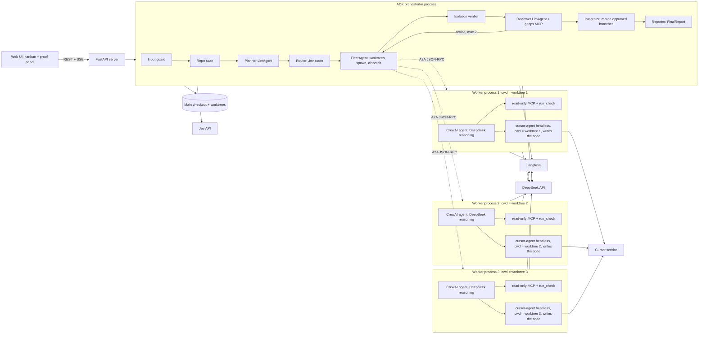
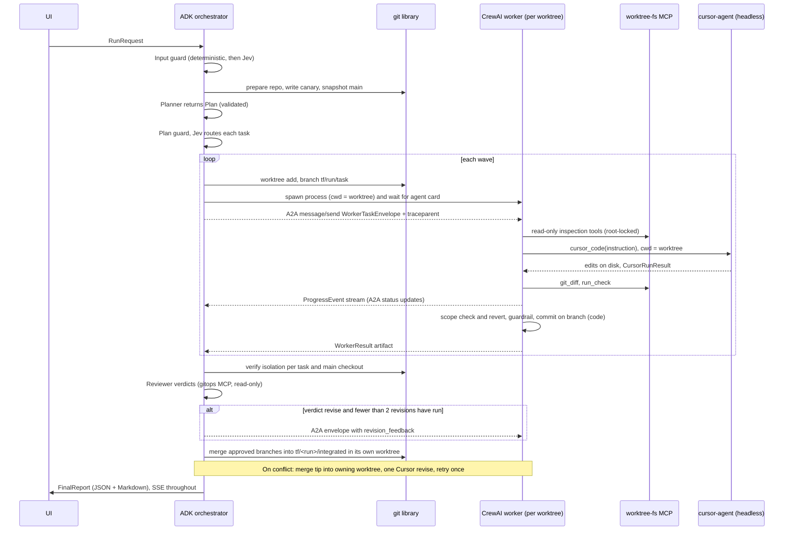

# TreeFleet architecture

TreeFleet is Agent Orchestrator (AO) rebuilt on Google ADK and CrewAI. It takes one goal, plans it into independent tasks, runs each task in its own git worktree with its own worker process, and proves the isolation with checks that never rely on what an agent says. The orchestrator is a Google ADK agent. Each worker is a CrewAI agent. They talk over the A2A protocol.

**Who does what.** Cursor CLI writes all the code. DeepSeek does the reasoning, planning, reviewing, orchestration and tool calling. Jev does cheap classification and decisions. No DeepSeek call ever edits a file. Each worker is a CrewAI agent that reasons on DeepSeek and drives one headless `cursor-agent` process inside its worktree, the way AO drives a CLI coding agent in each worktree.

Phase 0 is done. Measured outcomes are in the sections below and in `docs/spikes/summary.md`. Remaining verify tags belong to later phases.

## 1. Design principles

1. **Isolation is code, not prompts.** Worktree creation, process spawning, path guards, commits, merges and proofs are deterministic Python. No LLM decides any of them.
2. **Hub and spoke.** Workers never talk to each other. Every message goes through the orchestrator, so the information flow between worktrees is explicit, logged and guardable.
3. **Trust nothing a worker reports.** `WorkerResult.isolation` is a claim. `IsolationProof` is computed by the orchestrator from git and the OS.
4. **One contract file.** Every payload is a Pydantic model in `src/treefleet/contracts.py`.
5. **Three engines, three jobs.** Cursor CLI writes code and is the only thing that edits files. DeepSeek reasons: planning, composing the instruction for Cursor, inspecting results, reviewing. Jev classifies and gates with cheap typed calls and deterministic fallbacks.
6. **Fail closed on safety, fail open on cost optimizations.** A guard outage blocks the run. A Jev outage only loses savings.
7. **Cursor is untrusted too.** It edits through its own tools, outside our tool layer, so isolation rests on process cwd, scope diffs and orchestrator-computed proofs, not on tool locks alone.

## 1a. AO parity

| AO behavior | TreeFleet equivalent |
|---|---|
| One agent per task, each in its own branch and git worktree | One CrewAI worker process per task, branch `tf/<run>/<task>`, worktree created by deterministic code |
| A real coding agent CLI does the coding in the worktree | `cursor-agent` runs headless in the worktree and does all edits |
| Orchestrator decomposes work and spawns agents | ADK Planner, Router and FleetAgent |
| Review and CI feedback routed back to the owning agent | Reviewer verdicts and failed checks go back to the same worker as a revision envelope, max 2 |
| Dashboard of agents and their state | Web UI kanban and proof panel over SSE |
| Branches ready to merge or open as PRs | Integration branch with conflicts reported, patches exported, PR opening optional through `gh` |
| Runs locally on the developer's machine | Same, and a cloud deployment for the course |

The differences are deliberate: AO is a Go and desktop app. TreeFleet is Python, uses only ADK and CrewAI as agentic frameworks, speaks A2A between orchestrator and workers, and adds computed isolation proofs, guardrails and tracing.

## 2. Component map



## 3. Isolation model (what to tell the professor)

Isolation has five independent layers. A failure in one is caught by another.

| Layer | Mechanism | Enforced by |
|---|---|---|
| Filesystem checkout | `git worktree add <root>/<run>/<task> -b tf/<run>/<task> <base_ref>`. Each worktree has its own working tree and index. | Deterministic git code |
| Process | One OS process per worker. Its current working directory is the worktree. It receives a minimal environment: the DeepSeek key, a per-run A2A token, and nothing else. | Spawner |
| Tool scope | The CrewAI agent's own tools come from `worktree-fs-mcp`, started with `--root <worktree>`, and are read-only plus named checks. Paths resolve with `realpath`, so `..` and symlink escapes are rejected. The agent has no write tool. The only way to change a file is `cursor_code`, which launches `cursor-agent` with its working directory set to the worktree. S10, with `--sandbox disabled`, blocked neither a denied file nor a write outside the worktree. A per-worktree permission file is not a boundary. Isolation uses the scope diff and the proofs. The process is wrapped in a hard timeout and a process-tree kill. | MCP server code, Cursor tool wrapper |
| Scope contract | `TaskSpec.allowed_paths` and `denied_paths`. A CrewAI task guardrail and the orchestrator verifier both diff against them. | Guardrail + verifier |
| Evidence | `IsolationProof` per task and `MainCheckoutProof` for the main checkout. | Orchestrator verifier |

S10b on Windows: `--sandbox enabled` exits 1 before any edit. The CLI says the sandbox requires macOS or Linux. It is not an extra layer on Windows, and the Windows worker must not pass that flag. Out-of-worktree writes by Cursor are detected only inside the repo: main checkout status and HEAD, the canary, and sibling worktree snapshots. They are not detected elsewhere on disk. A container is the real boundary. The sandbox was not measured on Linux or macOS.

### Isolation when Cursor does the editing

1. **Process.** Cursor is a child of the worker, spawned with `cwd` = worktree, `shell=False`, a timeout, and a minimal environment that adds only the Cursor credential.
2. **Scope check after every Cursor run.** Plain code lists changed and untracked files in the worktree. Any path outside `allowed_paths` or inside `denied_paths` is reverted (`git checkout -- <path>`, `git clean` for untracked) and the run is recorded as a `scope_violation` event. The CrewAI task guardrail then fails the attempt.
3. **Outside-the-worktree check.** After each wave the orchestrator re-snapshots the main checkout and every sibling worktree. Any change that no task owns fails the proof.
4. **Prompt construction.** The CrewAI agent writes the Cursor instruction, always prefixed with the scope rules. The task text is data, and a deterministic header states allowed and denied paths and forbids git commands. The worker, not Cursor, commits.

### Isolation proof, computed per task

1. Walk the child process tree and read the cwd of the real interpreter, not the launcher. S7: the uv `Scripts\python.exe` launcher's cwd is the temp directory, and the child `uv\python\cpython-3.12-...\python.exe` has the worktree cwd. Apply the same walk to `cursor-agent`: the PowerShell launcher is not the process whose cwd counts.
2. `git -C <worktree> rev-parse --show-toplevel` equals the worktree path.
3. `git worktree list --porcelain` contains the worktree with branch `tf/<run>/<task>`.
4. The canary file written into the main checkout (`.treefleet_canary`, untracked, added to `.git/info/exclude`) does not exist inside the worktree.
5. `git diff --name-only <base_ref>...HEAD` plus untracked files all match `allowed_paths` and none match `denied_paths`.

### Main checkout proof

`git status --porcelain` and `git rev-parse HEAD` in the main checkout are captured before the run and after it. They must be identical, and the canary must still exist.

## 4. Technology decisions

| Decision | Choice | Reason |
|---|---|---|
| Language | Python 3.12 | Both frameworks and the A2A SDK are Python-first |
| Orchestrator | Google ADK 2.13.0 | Required. Native `RemoteA2aAgent`, callbacks, `LoopAgent`, `McpToolset` |
| Workers | CrewAI 1.15.30 with the `a2a` extra | Required. `A2AServerConfig` builds an agent card and does not serve HTTP (S3, crewai 1.15.30). An A2A SDK app serves the crew |
| Agent protocol | A2A over local HTTP, `a2a-sdk==0.3.26` in both environments | Required. Each worker serves an agent card at `/.well-known/agent-card.json`. An unconstrained install resolved 1.2.3, a different API (S4) |
| Tools | Two custom MCP servers built with the MCP Python SDK (FastMCP) | Satisfies the MCP requirement with real tools, plus Jev as a third external tool |
| Coding engine | Cursor CLI (`cursor-agent`) run headless in each worktree | Required. S10: `--print`, `--output-format json`, `--model`, `--workspace`, cwd = worktree, `--sandbox disabled`. JSON `usage` is the Cursor cost source. S10b: `--sandbox enabled` does not start on Windows. S11: `--api-key` / `CURSOR_API_KEY` exist, no key is set, an existing login is present, container not tested. Demo runs locally |
| Reasoning LLM | DeepSeek through LiteLLM. ADK uses `LiteLlm`. CrewAI uses its LiteLLM-backed `LLM`. Fast tier `deepseek/deepseek-flash`. Strong tier `deepseek/deepseek-v4-pro` | Planning, instruction writing, result inspection, review and tool calling. Never edits files. S1: tool calls work. `response_format` is unavailable, so planner and reviewer produce JSON that is parsed with Pydantic, with one repair retry that sends the validation error back. Phase 3 validates `WorkerDraft` JSON itself and must not rely on CrewAI `output_pydantic` |
| Typed decisions | Jev over HTTPS with `httpx` | Cheap classification, routing, guard first pass |
| Observability | Langfuse with OpenInference instrumentors for ADK and CrewAI | Both have official integrations |
| API and UI | FastAPI, server-sent events, one static page | Least moving parts |
| Cloud | Google Cloud Run, one container | ADK-native, simple. Confirm account in Phase 10 |
| Packaging | `uv`, `pyproject.toml`, ruff, pyright, pytest | Fast, cross-platform |
| Environments | Two virtualenvs: `.venv-orch` (ADK) and `.venv-worker` (CrewAI) | S8: both import in one environment (google-adk 2.13.0, crewai 1.15.28). Two environments stay, because the processes are separate |

Framework-rule check for requirement 7. The only agentic frameworks used are ADK and CrewAI. LiteLLM (model client, used by both), the A2A SDK (protocol, used by both), the MCP SDK (protocol), `httpx`, FastAPI and Pydantic are libraries, not agentic frameworks. Get this confirmed by the professor in one line of email, and keep the reply.

## 5. Agent roster

| Agent | Framework | Model tier | Tools | Output |
|---|---|---|---|---|
| InputGuard | ADK callback + deterministic code + Jev | none or Jev | none | `GuardDecision` |
| RepoScan | ADK `BaseAgent`, deterministic | none | git library | `repo_map` text in state |
| Planner | ADK `LlmAgent` | strong | none | `Plan` |
| Router | ADK `BaseAgent` | Jev | Jev score | `RouteDecision` per task: `cursor_model` and `source` |
| FleetAgent | ADK custom `BaseAgent`, deterministic | none | git library, process spawner, A2A client | `WorkerResult` per task |
| Verifier | ADK `BaseAgent`, deterministic | none | git library, psutil | `IsolationReport` |
| Reviewer | ADK `LlmAgent` | strong | `gitops-mcp` read-only tools via `McpToolset` | `ReviewVerdict` per task |
| Integrator | ADK `BaseAgent`, deterministic | none | git library | `IntegrationReport` |
| Reporter | ADK `BaseAgent`, deterministic | none | none | `FinalReport` + Markdown |
| Worker brain | CrewAI `Agent` in each worker | DeepSeek, fast tier | `worktree-fs-mcp` (read-only and `run_check`), `cursor_code` | `WorkerDraft`, then code assembles `WorkerResult` |
| Coder | `cursor-agent` subprocess, driven by the worker brain | Resolved Cursor model (`--model` when set) | Cursor's own file tools, inside the worktree | Edits in the worktree, `CursorRunResult` |

Strong and fast models are config keys, not hardcoded names. They are DeepSeek reasoning models. The router maps Jev's complexity score to a Cursor model id.

### Model selection

Cursor writes the code, so the worker model is a Cursor model id. DeepSeek stays in config (`models.strong`, `models.fast`) and is not passed to `cursor-agent`.

`RunRequest.worker_model` defaults to `router`. That value means TreeFleet chooses per task. The UI label is Auto. Any other value is one Cursor model id for every task. `TaskSpec.model_override` wins for that task.

Resolution order: `model_override`, then `worker_model` when it is not `router`, then the tier table in `treefleet.toml` (`trivial`, `moderate`, and `complex` each name a Cursor model; if Jev or routing is unavailable, `models.router.default_tier`), then `models.default`, then omit `--model` and use the CLI default.

Phase 0 measured the flag as `--model` (`cursor-agent` 2026.10.22-27dcf5f). Until Phase 5 exists, a `router` run uses `models.router.default_tier` and does not call Jev for the tier.

Validation: an id matches `^[A-Za-z0-9._:/\-]{1,100}$` and, at run start, appears in the model list discovered from the Cursor CLI (cached for the process). `router` is the sentinel and is not looked up. An unknown id fails the run before any worktree is created. The message names the id and says to run `treefleet models`. Every selection emits `model_selected` with `task_id`, `model`, `source` (`override`, `run`, `router`, `default`), and `complexity`.

### Agentic design patterns in use (requirement 4)

| Pattern | Where |
|---|---|
| Orchestrator-workers | Planner decomposes, FleetAgent delegates over A2A |
| Parallelization | Tasks in one wave run concurrently with `asyncio.gather` |
| Routing | Jev complexity score selects the Cursor model per task through the tier table |
| Evaluator-optimizer | Reviewer verdict `revise`, failed local checks, and one integrate conflict each send `revision_feedback` back to the same worker (`LoopAgent` semantics). Conflict resolve is Cursor in the owning worktree, never an LLM merge outside Cursor |
| Guardrail / validation | Layered guards at six stages, see section 8 |
| Human-in-the-loop hook | Worker `InputRequired` and Jev low confidence surface as `needs_human` cards |

## 6. Run sequence



## 7. A2A topology

- One worker process per task. Port from a configured range (default 9101 upward), bound to `127.0.0.1`.
- Each worker serves an agent card with one skill, `implement_task`. The card carries the task id in its name so the UI can label it.
- Auth: a random per-run token, passed to the worker as an environment variable and sent by the orchestrator as a bearer header. CrewAI's server defaults to token auth read from `AUTH_TOKEN`.
- Client side: for each worker, a `RemoteA2aAgent` is the root of a dedicated ADK `Runner` with its own session. `FleetAgent` drives the runners with `asyncio.gather` and writes results into the main session state. S4: this works with `a2a-sdk` 0.3.26, including a `DataPart` round trip and two parallel runners. Both extras pin `a2a-sdk==0.3.26`. ADK marks `RemoteA2aAgent` experimental.
- Server side: workers are A2A SDK apps. The executor runs the crew. `A2AServerConfig` only injects `to_agent_card` (S3, crewai 1.15.30) and does not serve HTTP, stream, or return input-required. The worker is still a CrewAI agent behind that endpoint.
- Streaming: if the card says streaming is false, progress arrives only at completion. ADK-served cards default to non-streaming, and ADK may not mark such events final. Plan for polling the A2A task, and set `capabilities.streaming` explicitly in the worker card.
- No peer messaging. Cross-task information moves in one direction: upstream `WorkerResult` summaries are copied into a downstream `WorkerTaskEnvelope.upstream`.

## 8. Guardrails and security (requirement 8)

| Stage | Check | Implementation | On failure |
|---|---|---|---|
| `input` | Length, Unicode normalization (strip zero-width and bidi characters), blocked patterns, then Jev `noul` for prompt injection and toxic or abusive language, then topic fit | ADK `before_agent_callback` on the root | Block, `GuardDecision`, run ends |
| `plan` | Pydantic validity, task count, `allowed_paths` sane, no path escapes, no `.git` | Callback after Planner | Re-plan once, then stop |
| `tool_args` | Path inside root after `realpath`, command is a named check, size limits. For `cursor_code`: instruction length cap, mandatory scope header, no raw secrets | ADK `before_tool_callback`, CrewAI tool wrapper, and inside `worktree-fs-mcp` | Tool call refused, error returned to the LLM |
| `tool_result` | Result validates against a Pydantic model, size cap, secret patterns redacted | ADK `after_tool_callback`, and MCP server | Result replaced with a typed error |
| `task_output` | `WorkerDraft` validates, git diff stays in scope. Out-of-scope edits made by Cursor are reverted first | CrewAI task `guardrail` (retries via `guardrail_max_retries`) | Retry, then `failed` |
| `final_output` | Secret redaction, schema validation | Reporter | Redact, never fail the run on redaction |

Jev is a convenience layer, not the defense. A security vendor reported Jev falls to attacks such as TokenBreak that larger LLMs resist. Deterministic checks run first and cannot be skipped. If Jev is unreachable the deterministic guard still runs, and a DeepSeek classification prompt replaces it for the injection check.

Indirect injection is covered by design. Repo content a worker reads is data. The worker's tools cannot leave the root or run free-form commands, so an injected instruction to read `../../.ssh` fails at the tool layer, and the attempt is logged as a `tool_args` denial.

## 9. State and context sharing (requirement 1)

ADK `session.state` is the shared blackboard. The key contract is in `contracts.StateKey` and `docs/CONTRACTS.md` section 4. The chain is: request, guard log, repo map, plan (Planner `output_key`), routing, worker results (written by FleetAgent), isolation, verdicts (Reviewer), integration, report. Each agent reads only what the previous stage wrote. Workers do not see session state. They see only their `WorkerTaskEnvelope`.

## 10. Observability and callbacks (requirements 5 and 9)

- Every callback in both frameworks emits a `RunEvent` through one `EventSink` interface. The sink writes JSONL to `runs/<run_id>/events.jsonl`, pushes to the SSE stream, and adds a Langfuse span event.
- ADK callbacks: before and after agent, model and tool. CrewAI: task `callback` and task `guardrail`. Phase 0 did not record an agent-level step hook name.
- Langfuse: initialize the client, then call `GoogleADKInstrumentor().instrument()` in the orchestrator and `CrewAIInstrumentor().instrument()` in each worker, before any agent code runs. Call `langfuse.flush()` at shutdown.
- Trace stitching: the orchestrator puts a W3C `traceparent` in each A2A message's metadata and in `WorkerTaskEnvelope.trace`. The worker extracts it with OpenTelemetry propagation so its spans nest under the orchestrator's. **[verify P7]** Fallback that always works: set the same Langfuse session id (`run_id`) and tags on every trace, so Langfuse groups the whole run.
- Provenance: every `WorkerResult` carries `head_sha` and `branch`. Every Jev call, tool call and guard decision is an event with a timestamp and task id. The JSONL plus the Langfuse trace is the audit trail.

## 11. Cost, speed and Jev (requirement 10 and the cost goal)

- Jev adapter: `POST https://api.typesafe.ai/v1/systemone` with `httpx`, retries on 429 and 529 honoring `Retry-After`, an in-memory cache keyed by the request body, strict Pydantic parsing of answers.
- Where Jev is used: guard first pass (`noul`), complexity routing (`score`), review pre-checks (`noul` scope check), and relevance filtering of long tool outputs inside `worktree-fs-mcp` before they reach the worker model. Pruning at the MCP layer is deliberate: it works regardless of how CrewAI manages its own message history.
- Other levers: strong model only for planner and reviewer, fast model for workers, identical system prompt and tool definitions first in every request so provider prefix caching applies, step and output caps from `Limits`, output truncation in tools.
- Cursor cost: Cursor usage is billed by Cursor, not by DeepSeek. `cursor-agent --output-format json` reports a `usage` object (`inputTokens`, `outputTokens`, `cacheReadTokens`, `cacheWriteTokens`). The cursor cost row uses that object and the Cursor model id. If the CLI returns no usage, the row says `usage not reported` and does not reuse the DeepSeek counts. The worker row is the DeepSeek brain. A single-task run prints `n/a (single task)` for the speedup lines.
- Measurement: costs are never hand-entered. Token usage comes from the frameworks' usage metadata. Prices come from the LiteLLM cost map, and Jev's published rate (`$0.042` per million input tokens, output not billed) is a config value with its source URL beside it. The eval harness runs an ablation, Jev on versus off.

## 12. Deployment (requirement 11)

- One container on Cloud Run: FastAPI orchestrator, plus worker subprocesses on loopback ports. The image includes `git` and both virtualenvs. The spawner launches workers with the worker environment's Python.
- Worker subprocesses need CPU while no request is in flight, so deploy with CPU always allocated (instance-based billing), a generous request timeout, and SSE for the UI **[verify P10]**.
- Cursor in the container: S11 found `--api-key` and `CURSOR_API_KEY`, and did not run the container. The key is unset here. The CLI is already logged in from a browser session, so the demo runs locally. A container image would install the CLI and pass `CURSOR_API_KEY`. That path is unmeasured. If a later container run cannot log in, deploy the workers on a VM where the CLI was logged in once.
- The target repository is cloned into the container's temp directory at run start. Worktrees live beside it. All of it is ephemeral, so branches are pushed to a results remote or exported as patches before shutdown. Default: export `git format-patch` bundles into the run artifact, downloadable from the UI.
- Secrets (DeepSeek, Jev, Langfuse, GitHub token if the repo is private) come from Secret Manager as environment variables. Nothing is baked into the image.
- Windows development and Linux cloud both must pass the same test suite. Windows risks: path length (use a short worktree root such as `C:\wt`), file locks when removing worktrees (stop the worker first), CRLF noise in diffs (`core.autocrlf=false` in the worktree config), symlink privileges in tests.

## 13. Failure handling

| Failure | Behavior |
|---|---|
| Worker fails to start or card never appears | Mark task `failed`, kill process, continue other tasks |
| `cursor-agent` hangs, exits non-zero, or is not logged in | Kill its process tree, record `CursorRunResult`, one retry, then `failed`. A preflight `cursor-agent --version` and auth check runs before any run starts |
| Cursor edits outside `allowed_paths` | Revert those paths, emit `scope_violation`, fail the attempt through the guardrail |
| Worker exceeds `timeout_s` | Cancel the A2A task, kill the process, `failed` |
| Guardrail retries exhausted | `failed` with the last guard message |
| Reviewer still says `revise` after two revisions | Verdict `reject` for that task, excluded from integration |
| Merge conflict | Reported in `IntegrationReport.conflicts`, task branches untouched, no auto-resolution |
| Jev error | Deterministic or DeepSeek fallback, event logged, run continues |
| Isolation proof fails | Run marked failed loudly, evidence kept, integration skipped |
| Orchestrator crash | Worktrees and branches persist. `treefleet cleanup <run_id>` removes them |

## 14. Repository layout

```
treefleet/
  AGENTS.md  pyproject.toml  treefleet.toml
  src/treefleet/
    contracts.py  config.py  events.py
    git/            worktrees.py  proofs.py  canary.py  merge.py
    mcp_servers/    gitops_server.py  worktree_fs_server.py
    jev/            client.py
    guards/         input_guard.py  tool_guard.py  output_guard.py
    orchestrator/   agents.py  fleet.py  callbacks.py  pipeline.py
    worker/         main.py  crew.py  a2a_server.py  callbacks.py
    obs/            tracing.py
    api/            server.py  static/
    evals/          scenarios.py  harness.py  report.py
  tests/  scripts/gate.py
  deploy/  Dockerfile  deploy.sh
  docs/  ARCHITECTURE.md  CONTRACTS.md  PHASES.md  REQUIREMENTS_TRACE.md  STATUS.md  spikes/
```

## 15. Decisions still needed from Hemang

1. PR Sentinel: repository URL, public or private, language, and the real test and lint commands (they become `RunRequest.checks`).
2. UI design direction (reference sites, palette, typography) before Phase 8.
3. Whether a Google Cloud account with billing is available, or whether to deploy elsewhere.
4. Langfuse Cloud free tier or self-hosted.
5. One-line written confirmation from the professor on the framework rule (section 4). Add that Cursor CLI is an external coding tool and not an agentic framework in the project.
6. Which Cursor model to use and how Cursor is billed on your plan (subscription or API key), and whether the CLI can authenticate with an API key in a container.
